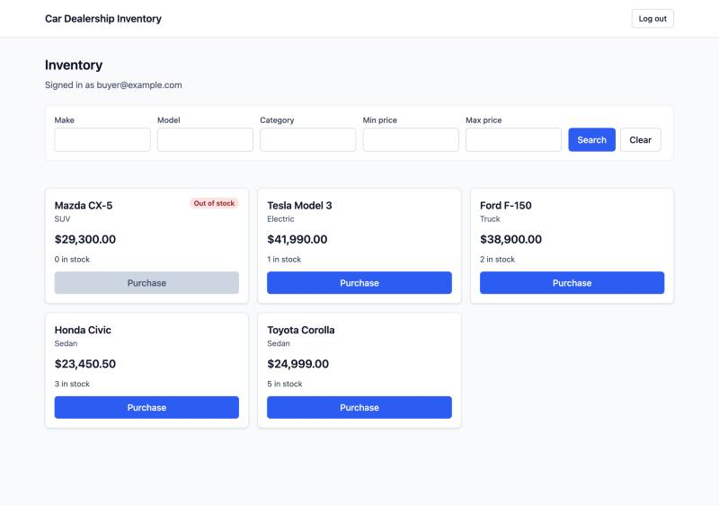
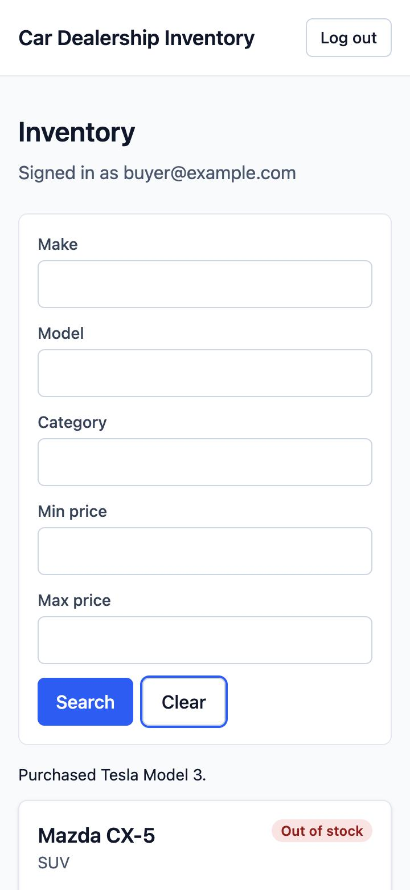
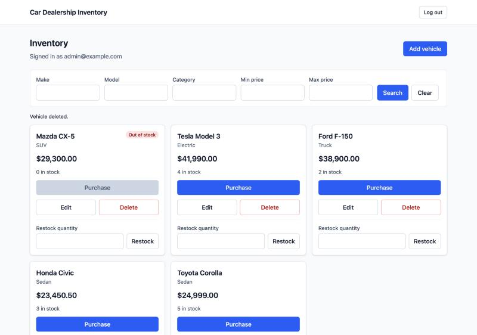
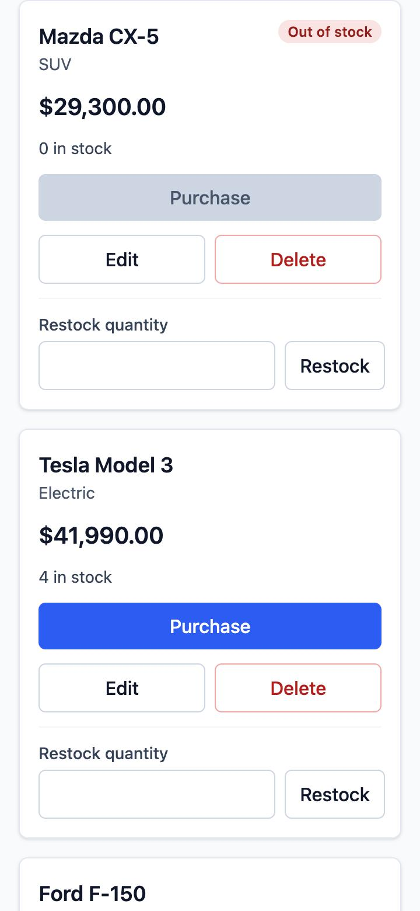
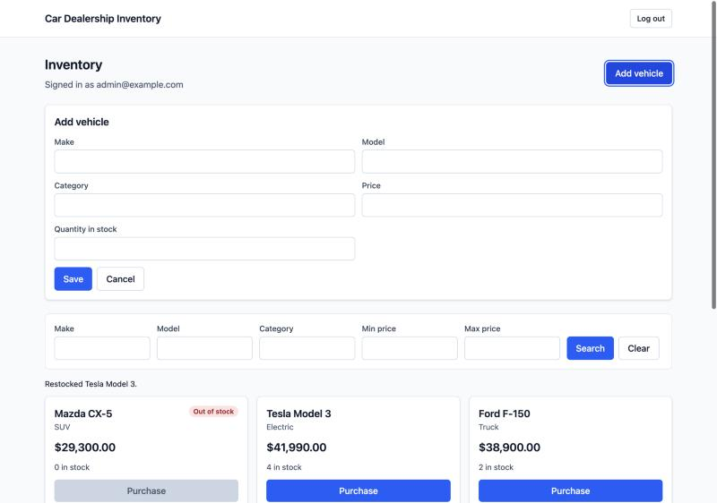

# Car Dealership Inventory System

A full-stack vehicle inventory management application built using test-driven development (TDD).

## Tech Stack

### Backend
- Python
- FastAPI
- PostgreSQL
- SQLAlchemy 2.0
- Pydantic
- Alembic

### Frontend
- React
- Vite
- TypeScript
- Tailwind CSS

### Testing
- pytest
- HTTPX
- PostgreSQL integration tests
- Vitest
- React Testing Library

## Prerequisites

- Docker (for PostgreSQL 16)
- Python 3.12
- Node.js 24 and npm

## Setup and Running

All commands run from the repository root unless a `cd` says otherwise.

### 1. Start PostgreSQL

```bash
docker compose up -d
```

This starts PostgreSQL 16 on `127.0.0.1:5435` and creates two databases: `dealership` for the app and `dealership_test` for the test suite.

### 2. Backend

```bash
python3.12 -m venv .venv
source .venv/bin/activate
pip install -r backend/requirements-dev.txt
cp backend/.env.example backend/.env
```

Edit `backend/.env` and set `JWT_SECRET_KEY` to a random value:

```bash
python -c "import secrets; print(secrets.token_urlsafe(32))"
```

Create the schema and start the API on port 8001:

```bash
cd backend
alembic upgrade head
uvicorn app.main:app --port 8001 --reload
```

Interactive API docs are at http://localhost:8001/docs.

### 3. Create an admin

Registration only creates customers. Admins are created from the command line (run inside `backend/` with the virtual environment active); it prompts for the password twice:

```bash
python -m app.cli create-admin --email admin@example.com
```

### 4. Frontend

```bash
cd frontend
npm install
cp .env.example .env.local
npm run dev
```

Open http://localhost:5173, register a customer or log in as the admin.

### Environment variables

| File | Variable | Purpose |
|---|---|---|
| `backend/.env` | `DATABASE_URL` | App database |
| `backend/.env` | `TEST_DATABASE_URL` | Test database; its name must end in `_test` |
| `backend/.env` | `JWT_SECRET_KEY` | HS256 signing key, at least 32 random bytes |
| `backend/.env` | `JWT_EXPIRES_MINUTES` | Optional token lifetime (default 30) |
| `backend/.env` | `CORS_ORIGINS` | Optional JSON list of allowed origins (default `["http://localhost:5173"]`) |
| `frontend/.env.local` | `VITE_API_BASE_URL` | Backend URL (default `http://localhost:8001`) |

## Running the Tests

Backend (needs PostgreSQL running; uses `dealership_test`):

```bash
cd backend
pytest --cov=app --cov-report=term-missing
```

Frontend:

```bash
cd frontend
npm run test:coverage
```

Other frontend checks: `npm run lint`, `npm run format:check`, `npm run typecheck`, `npm run build`.

The latest results are in [`docs/test-report.md`](docs/test-report.md).

## Requirements Specification

See [`docs/SRS.md`](docs/SRS.md) for the finalized Software Requirements Specification.

## Development Status

- [x] Requirements specification
- [x] Project scaffolding
- [x] Database schema and migrations
- [x] Authentication and authorization
- [x] Vehicle and inventory APIs
- [x] Frontend implementation
- [x] Integration testing
- [ ] Final documentation and submission

## Screenshots

Taken in the running app with sample data, at 1280 px and 360 px wide.

| | Desktop (1280 px) | Mobile (360 px) |
|---|---|---|
| Customer |  |  |
| Admin |  |  |



## My AI Usage

### Tools used

- **Claude (Claude Code, Anthropic):** used across the project as a pair programmer.
- **ChatGPT (OpenAI):** used to write some of the prompts for creating the Software Requirements Specification (`docs/SRS.md`).

### How I used Claude

- **Planning:** turning `docs/SRS.md` into phases (scaffolding, database, auth, vehicle and inventory APIs, frontend, documentation) and comparing options at each decision point. Examples: Docker PostgreSQL on port 5435, sync SQLAlchemy, Alembic autogenerate with manual review and an `alembic check` drift guard, duplicate emails handled by insert-and-catch, `vi.mock` for API modules, and plain React state for forms. I made each choice after Claude explained the trade-offs.
- **Test-first development:** Claude drafted the failing tests for each cycle from the SRS requirements, then the code to make them pass, and explained both. The history shows this as `test: … (red)` commits followed by `feat:` commits.
- **Running checks:** Claude ran pytest, Vitest, ESLint, Prettier, the type checker and the build, and reported the real output.
- **Debugging:** for example, a flaky `Allow` header assertion (fixed by comparing as a set), test factories whose setup was rolled back by a failed request (fixed by committing), and a concurrency test that only passed because of timing (fixed by connecting the threads before the barrier).
- **Live check and documentation:** Claude exercised the running app in a browser, took the README screenshots, and drafted this README, `docs/test-report.md` and the outline of `PROMPTS.md`.

### How the work was split

- **Phases 1–3 (scaffolding, database, auth):** I ran every command myself, following Claude's step-by-step instructions.
- **Phases 4 to 6.4:** Claude wrote the files, ran the checks and committed locally. I reviewed each cycle and pushed.
- **Cycles 6.5–6.9:** I applied the changes, committed and pushed myself.
- **Final frontend cycles and documentation:** Claude wrote, checked and committed locally. I reviewed and pushed.

Every commit Claude helped with ends with `Co-authored-by: Claude <AI@users.noreply.github.com>` and has a short note on what the AI did. The first two commits (repository setup and scaffolding) have no trailer.

### Reflection

During this project, I used AI as a development assistant to speed up implementation and improve my understanding of the technologies I was working with. It helped me write boilerplate code, set up the project structure, create tests, and explore different approaches to solving problems. Whenever there were multiple ways to implement something, AI explained the available options, their trade-offs, and the reasons for choosing one approach over another. I researched these options, made the final decisions myself, implemented the changes, and ran the tests to verify the behaviour. When a test failed, I used AI to understand why it failed, identify the underlying issue, and work towards a solution rather than simply accepting the generated code. I also asked it to explain unfamiliar technical concepts and terms that I encountered during development, which helped me learn while building the application. Overall, AI significantly accelerated my development process, reduced time spent on repetitive tasks, and helped me focus more on problem-solving, testing, design decisions, and understanding the code rather than just writing it.

Raw prompts and conversation links are in [`PROMPTS.md`](PROMPTS.md).
