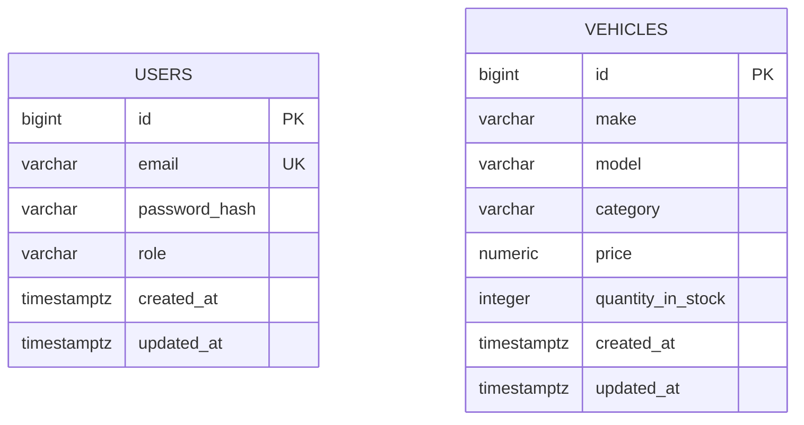
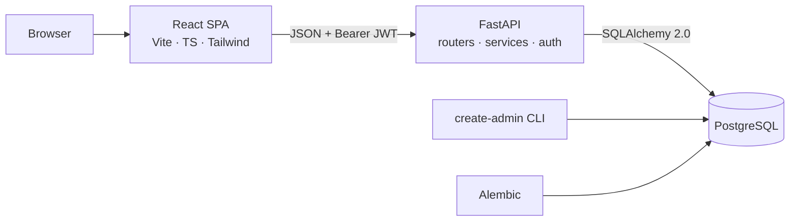

# Software Requirements Specification — Car Dealership Inventory System

| Item | Value |
|---|---|
| Document | `docs/SRS.md` |
| Version | 2.0 (simplified MVP, draft for review) |
| Date | 2026-10-23 |
| Status | Pre-implementation. No code, tests, commits, screenshots or reports exist yet. |
| Primary source | *TDD Kata: Car Dealership Inventory System* (the "Brief") |

**Changes in 2.0:** the scope is reduced to the Brief's mandatory requirements plus a small set of documented design decisions. The following are removed or deferred:
- stock adjustment, the health endpoint, the stock ceiling and vehicle-identity uniqueness
- sorting, pagination and the in-stock filter
- purchase confirmation, category suggestions, the expiry banner, cross-tab logout and draft preservation

Optional items are listed in §11.3.

---

## 1. Introduction and Objectives

### 1.1 Purpose

This SRS is the implementation guide for the Car Dealership Inventory System. It defines what to build, how each requirement is tested, and what "done" means. Every requirement is traceable to the Brief or to a labelled design decision.

### 1.2 Objectives

1. Deliver a working full-stack application: authentication, vehicle management, search, purchase and restock, backed by PostgreSQL.
2. Demonstrate genuine Test-Driven Development, visible in the Git history as Red → Green → Refactor.
3. Keep inventory correct: stock is never negative and never oversold, even under concurrent purchases.
4. Produce every deliverable the Brief requires, with transparent AI usage.

### 1.3 Definitions

| Term | Meaning |
|---|---|
| Visitor | Unauthenticated client |
| Customer | User with `role = customer`, created by public registration |
| Admin | User with `role = admin`, created only by the setup CLI |
| Stock | `vehicles.quantity_in_stock` |
| Purchase | An inventory transaction that decrements stock by one. No payment is involved. |
| Error envelope | The standard JSON error body (§4.2) |

### 1.4 Brief references

| Tag | Brief section |
|---|---|
| B-1.1 | Backend technology choice |
| B-1.2 | Persistent database (in-memory alone not sufficient) |
| B-1.3 | Register, login, token-based authentication |
| B-1.4 | Vehicle endpoints (protected; delete is admin only) |
| B-1.5 | Purchase and restock endpoints (protected; restock is admin only) |
| B-1.6 | Vehicle attributes: unique ID, make, model, category, price, quantity |
| B-2 | Frontend: React, HTML5, CSS3 and Tailwind; required screens and behaviors; responsive and good UX |
| B-3.1 | TDD with visible Red–Green–Refactor; high, meaningful coverage |
| B-3.2 | Clean code, SOLID, clear module boundaries |
| B-3.3 | Git with frequent, descriptive commits |
| B-3.4 | AI co-author trailers; README "My AI Usage" |
| B-4 | Deliverables: public repository, README, setup instructions, screenshots, My AI Usage, test report, `PROMPTS.md` |
| B-4.B | Optional deployment |
| B-4.I | Academic integrity |

### 1.5 Conventions

- **MUST** means mandatory, **SHOULD** means recommended, **MAY** means optional.
- `[B-x]` marks a requirement taken from the Brief. `[A-xx]` marks a design decision or assumption, listed in §11.1.
- Requirement IDs: `FR-AUTH`, `FR-VEH`, `FR-INV`, `FR-UI`, `NFR-*`. Test IDs: `T-<area>-NN`.
- Numbers marked "proposed" are project goals, not Brief mandates.

---

## 2. Scope and User Roles

### 2.1 In scope (MVP)

- **Backend:** FastAPI with registration and login (JWT); role-based access; vehicle create, list, search, update and delete; purchase of one unit and restock; PostgreSQL via SQLAlchemy 2.0 and Alembic.
- **Frontend:** a React + Vite + TypeScript + Tailwind SPA with register and login screens, a vehicle dashboard, search, purchase, and admin vehicle and restock controls.
- **Process:** backend and frontend tests written test-first; README, screenshots, test report, My AI Usage and `PROMPTS.md`.

### 2.2 Out of scope

Payments, reservations, purchase history, multi-unit purchase, email features, password reset, refresh tokens, user-management UI, public browsing, and the deferred items in §11.3.

### 2.3 Operating environment and constraints

| Item | Decision |
|---|---|
| Backend | Python 3.12+ (proposed), FastAPI, Uvicorn [B-1.1] |
| Database | PostgreSQL 15+ (proposed), with separate development and test databases [B-1.2] |
| ORM and migrations | SQLAlchemy 2.0 typed models, Alembic |
| Frontend | Node.js 20 LTS+ (proposed), Vite, React, TypeScript (strict), Tailwind CSS [B-2] |
| Browsers | Current Chrome, Firefox, Safari and Edge, including mobile |
| Constraints | No microservices, queues, caches or cloud infrastructure. An optional `docker-compose.yml` MAY run PostgreSQL only. |

**Proposed dependencies.**
- Backend: `fastapi`, `uvicorn`, `sqlalchemy>=2`, `psycopg`, `alembic`, `pydantic>=2`, `pydantic-settings`, `pyjwt`, `pwdlib[argon2]`, `email-validator`. Dev: `pytest`, `pytest-cov`, `httpx`, `ruff`.
- Frontend: `react`, `react-router-dom`, `tailwindcss`. Dev: `vitest`, `@testing-library/react`, `@testing-library/user-event`, `@testing-library/jest-dom`, `jsdom`, `@vitest/coverage-v8`, `eslint`, `prettier`.

### 2.4 Permissions

The Brief marks only delete and restock as "Admin only". It also requires "Admin-only forms and UI for adding, updating, and deleting vehicles" [B-2]. Create and update are therefore admin-only in the backend as well, so the frontend and backend agree (A-01).

| Operation | Endpoint | Visitor | Customer | Admin | Source |
|---|---|---|---|---|---|
| Register | `POST /api/auth/register` | Yes | N/A | N/A | B-1.3 |
| Log in | `POST /api/auth/login` | Yes | Yes | Yes | B-1.3 |
| List vehicles | `GET /api/vehicles` | No | Yes | Yes | B-1.4 (protected) |
| Search vehicles | `GET /api/vehicles/search` | No | Yes | Yes | B-1.4 (protected) |
| Purchase | `POST /api/vehicles/{id}/purchase` | No | Yes | Yes | B-1.5; admin purchase A-02 |
| Create vehicle | `POST /api/vehicles` | No | No | Yes | A-01 |
| Update vehicle | `PUT /api/vehicles/{id}` | No | No | Yes | A-01 |
| Delete vehicle | `DELETE /api/vehicles/{id}` | No | No | Yes | B-1.4 |
| Restock | `POST /api/vehicles/{id}/restock` | No | No | Yes | B-1.5 |

"No" for a visitor means `401`. "No" for a customer means `403`. The backend enforces every rule; hiding controls in the UI is not a security measure.

### 2.5 Admin provisioning (A-03)

- Public registration always creates `role = customer`. A request body containing `role` (or any other unknown field) is rejected with `422`.
- No HTTP endpoint creates admins or changes roles.
- Admins are created with a backend CLI, e.g. `python -m app.cli create-admin --email admin@example.com`.
  - The password is entered with hidden prompt and confirmation, or read from the `ADMIN_PASSWORD` environment variable for scripted setup.
  - The password follows the same policy and hashing as registration.
  - The command fails if the email already exists.
- No default admin credentials may exist in code, migrations or committed seed files.

---

## 3. Functional Requirements

Each requirement lists its actor, preconditions, behavior, failure conditions, acceptance criteria and source. HTTP details are in §4 and are not repeated here.

### 3.1 Authentication

**FR-AUTH-001 — Register a customer account** · Actor: Visitor · Source: B-1.3, A-03
- *Preconditions:* the email is not registered.
- *Behavior:* trims and lower-cases the email; validates and hashes the password (FR-AUTH-003); stores the user with `role = customer`; returns `201` with the public user (`id`, `email`, `role`, `created_at`). No token is issued.
- *Failure:* invalid email or password, or unknown fields including `role` → `422`. Duplicate → FR-AUTH-002.
- *Acceptance:* the stored role is `customer`; the response contains no password or hash; a body with `"role": "admin"` returns `422` and creates no user.

**FR-AUTH-002 — Reject duplicate email** · Actor: Visitor · Source: B-1.3, A-04
- *Behavior:* emails are compared case-insensitively. A duplicate returns `409 EMAIL_ALREADY_REGISTERED` and nothing is created. A unique-constraint violation caused by a race also maps to `409`.
- *Acceptance:* registering `A@x.com` after `a@x.com` returns `409`, and the user count is unchanged.

**FR-AUTH-003 — Password policy and hashing** · Actor: System · Source: B-1.3, A-05
- *Behavior:* the password must be 8–128 characters. It is hashed with Argon2id. Plaintext is never stored, logged or returned.
- *Failure:* out-of-range length → `422`.
- *Acceptance:* the stored hash starts with `$argon2id$`; verification succeeds for the correct password and fails for a wrong one.

**FR-AUTH-004 — Log in and issue a JWT** · Actor: Customer or Admin · Source: B-1.3, A-06
- *Behavior:* normalizes the email and verifies the password. Returns `200` with `access_token`, `token_type: "bearer"`, `expires_in` (seconds) and the public `user`. The token is HS256-signed with claims `sub` (user id), `iat` and `exp`. The lifetime defaults to 30 minutes and is configurable.
- *Acceptance:* the token decodes with the server secret, `exp − iat` equals the configured lifetime, and the token grants access to `GET /api/vehicles`.

**FR-AUTH-005 — Reject invalid credentials** · Actor: Visitor · Source: B-1.3
- *Behavior:* an unknown email and a wrong password both return `401 INVALID_CREDENTIALS` with the same message.
- *Acceptance:* the two response bodies are identical.

**FR-AUTH-006 — Require a valid token on protected endpoints** · Actor: System · Source: B-1.3–B-1.5
- *Behavior:* every `/api/vehicles*` endpoint requires `Authorization: Bearer <token>`. The server verifies the signature, the algorithm (HS256 only), `exp`, and that the `sub` user still exists.
- *Failure:* all with `401` and the `WWW-Authenticate: Bearer` header:
  - missing, malformed, badly signed or wrong-algorithm token, or unknown user → `NOT_AUTHENTICATED`
  - expired token → `TOKEN_EXPIRED`
- *Acceptance:* each case returns its code, and nothing changes in the database.

**FR-AUTH-007 — Enforce admin-only operations** · Actor: Customer · Source: B-1.4, B-1.5, A-01
- *Behavior:* create, update, delete and restock return `403 FORBIDDEN` for customers. The role is read from the database on every request, not from the token. Authorization is checked before resource lookup, so a customer gets `403` even for a nonexistent id.
- *Acceptance:* for each admin-only endpoint, a customer receives `403` and the vehicle table is unchanged; an admin succeeds.

**FR-AUTH-008 — Provision admins via CLI** · Actor: Operator · Source: A-03
- *Behavior:* the command in §2.5 creates an admin user.
- *Failure:* an existing email, a password mismatch or a policy violation → non-zero exit, no change.
- *Acceptance:* after running the command, the new admin can log in and create a vehicle.

### 3.2 Vehicle management

**FR-VEH-001 — Create a vehicle** · Actor: Admin · Source: B-1.4, B-1.6, A-01
- *Behavior:* validates the body (FR-VEH-002), stores the vehicle and returns `201` with the full vehicle, including the database-generated `id` and timestamps. `quantity_in_stock` defaults to `0` when omitted.
- *Failure:* `401`, `403`; invalid data → `422`.
- *Acceptance:* the vehicle appears in `GET /api/vehicles` with identical values, and the price is stored exactly as a decimal.

**FR-VEH-002 — Validate vehicle data** · Actor: System · Source: B-1.6, A-07

| Field | Rule |
|---|---|
| `make`, `model`, `category` | Required string, trimmed, 1–50 characters after trimming |
| `price` | Required; JSON number or numeric string; greater than 0; at most 2 decimal places; at most 9,999,999,999.99 (the column limit); booleans rejected |
| `quantity_in_stock` | Create only; optional (default 0); strict integer from 0 to 10,000; floats, strings and booleans rejected |
| Any other field | Rejected, including `id`, `created_at` and `updated_at` |

- *Failure:* any violation → `422 VALIDATION_ERROR` with one `details` entry per field. Nothing is written.
- *Ids:* vehicle ids are a database `BIGINT` identity. They are never accepted from clients and never reused.

**FR-VEH-003 — List vehicles** · Actor: Customer or Admin · Source: B-1.4, A-08
- *Behavior:* returns `200` with a JSON array of **all** vehicles, including those with zero stock, ordered by `created_at DESC, id DESC`.
- *Acceptance:* an empty catalogue returns `[]`; a zero-stock vehicle is included.

**FR-VEH-004 — Search vehicles** · Actor: Customer or Admin · Source: B-1.4, A-09
- *Behavior:*
  - Optional filters: `make`, `model`, `category` and `min_price` / `max_price`.
  - Text filters use case-insensitive substring matching. Input characters `%`, `_` and `\` match literally.
  - Price bounds are inclusive.
  - Filters combine with AND. Blank parameters are ignored.
  - With no filters, the result equals the list. Ordering is the same as FR-VEH-003.
- *Acceptance:*
  - `make=toy` matches "Toyota".
  - `min_price=20000&max_price=20000` matches a vehicle priced 20000.00.
  - A search with no matches returns `200 []`.

**FR-VEH-005 — Validate search parameters** · Actor: System · Source: A-09
- *Behavior:* prices must be decimals ≥ 0 with at most 2 decimal places, and `min_price ≤ max_price`. Text filters are at most 50 characters. Unknown parameters are ignored.
- *Failure:* any violation → `422`.
- *Acceptance:* `min_price=500&max_price=100`, `min_price=-1` and `min_price=abc` each return `422`.

**FR-VEH-006 — Update a vehicle** · Actor: Admin · Source: B-1.4, A-01, A-10
- *Behavior:* `PUT` requires all of `make`, `model`, `category` and `price`, validated as in FR-VEH-002. It replaces those fields, refreshes `updated_at` and leaves `id`, `created_at` and stock unchanged. Returns `200` with the vehicle.
- *Failure:* `401`, `403`; a missing field or a `quantity_in_stock` field → `422` (stock changes only through purchase and restock); nonexistent id → `404`.
- *Acceptance:* the new values are visible in the list, and `updated_at` advances.

**FR-VEH-007 — Delete a vehicle** · Actor: Admin · Source: B-1.4, A-11
- *Behavior:* hard-deletes the vehicle and returns `204` with no body.
- *Failure:* `401`, `403`; nonexistent id (including a second delete) → `404`.
- *Acceptance:* the vehicle is absent from list and search results.

**FR-VEH-008 — Invalid and nonexistent ids** · Actor: System · Source: B-1.4, B-1.5
- *Behavior:* `{id}` must be a positive integer, otherwise `422`. A well-formed id with no matching row returns `404 VEHICLE_NOT_FOUND` for PUT, DELETE, purchase and restock.
- *Acceptance:* `abc`, `0` and `-1` each return `422`; an unused id returns `404`; no state changes.

### 3.3 Inventory

**FR-INV-001 — Purchase one unit** · Actor: Customer or Admin · Source: B-1.5, A-12
- *Behavior:* decrements stock by exactly 1 with one atomic conditional statement (§5.3) and refreshes `updated_at`. Returns `200` with the updated vehicle. No request body is required.
- *Failure:* `401`; nonexistent id → `404`; zero stock → FR-INV-002.
- *Acceptance:* stock goes from 3 to 2, and the response shows `quantity_in_stock: 2`.

**FR-INV-002 — Reject purchase at zero stock** · Source: B-1.5, B-2
- *Behavior:* returns `409 OUT_OF_STOCK`; stock stays 0.
- *Acceptance:* repeated attempts all return `409`, and stock is still 0.

**FR-INV-003 — No overselling, no negative stock** · Source: B-1.5, A-13
- *Behavior:* stock changes only through conditional SQL updates, never by reading the value, modifying it in Python and writing it back. A `CHECK (quantity_in_stock >= 0)` constraint guards the database. With stock `k` and `N` concurrent purchase requests, exactly `min(N, k)` succeed, the rest return `409`, and final stock is `max(k − N, 0)`.
- *Acceptance:* T-INV-06, T-INV-07 and T-DB-03 pass against real PostgreSQL.

**FR-INV-004 — Restock** · Actor: Admin · Source: B-1.5
- *Behavior:* the body is `{"quantity": n}`. Stock increases by `n` atomically (`quantity_in_stock = quantity_in_stock + n`) and `updated_at` is refreshed. Returns `200` with the updated vehicle.
- *Failure:* `401`, `403`; nonexistent id → `404`; invalid quantity → FR-INV-005.
- *Acceptance:* restocking 5 takes stock from 0 to 5.

**FR-INV-005 — Validate restock quantity** · Source: B-1.5, A-07
- *Behavior:* `quantity` is a required strict integer from 1 to 10,000. This limit, like the 0–10,000 limit on initial stock in FR-VEH-002, validates a single request only. It is not a maximum total inventory: stock may exceed 10,000 through repeated restocks.
- *Failure:* `0`, negative values, `1.5`, `"5"`, `true`, a missing field, unknown fields, or a value above 10,000 → `422`, with stock unchanged.

**FR-INV-006 — Failed operations leave stock unchanged** · Source: A-13
- *Behavior:* one request uses one transaction. Any exception rolls it back, and the response is sent only after commit.
- *Acceptance:* every `4xx` path on purchase and restock leaves stock as it was; a forced database error during purchase leaves stock unchanged (T-INV-11).

### 3.4 Frontend

**FR-UI-001 — Registration screen** · Source: B-2, A-14
- Labelled email, password and confirm-password fields with client-side checks that mirror FR-AUTH-001/003.
- On success, the app logs in automatically and opens the dashboard.
- A `409` shows "An account with this email already exists." on the email field.

**FR-UI-002 — Login screen** · Source: B-2
- Email and password fields. Success stores the session (§6, NFR-SEC-007) and opens the dashboard.
- A `401` shows the generic credentials error and keeps the email field filled.

**FR-UI-003 — Protected routes, logout and expiry** · Source: B-2, A-06
- The dashboard requires a session; without one, the app redirects to `/login`.
- A logout control clears the session.
- Any API `401` clears the session and redirects to login. For `TOKEN_EXPIRED`, the login page shows "Your session has expired. Please log in again."
- A stored session whose `expires_at` has passed is discarded when the app loads.

**FR-UI-004 — Vehicle dashboard and stock display** · Source: B-2, A-15
- Vehicles appear as cards in a grid. Each card shows make, model, category, price formatted as currency, and stock ("N in stock").
- At 0 stock, the card shows an "Out of stock" badge that uses text, not colour alone.

**FR-UI-005 — Search and filtering** · Source: B-2
- Inputs for make, model, category, and min and max price.
- With no filters set, the app calls `GET /api/vehicles`. Otherwise it calls `/search` with only the non-empty filters.
- A Clear button resets the filters and reloads the list.
- min > max is blocked client-side with an inline error. A server `422` shows field errors.

**FR-UI-006 — Purchase button** · Source: B-2
- Every card has a Purchase button, disabled (native `disabled`) when stock is 0.
- While a request is pending, the button is disabled with a busy state, preventing double submission.
- `200`: the card shows the stock from the response, and a success message appears.
- `409`: the card shows stock 0 and the message "This vehicle just sold out."
- `404`: the list reloads and the message "This vehicle is no longer available" appears.

**FR-UI-007 — Admin add, edit and delete** · Source: B-2, A-01
- An Add form (make, model, category, price, initial stock) and an Edit form pre-filled from the card (no stock field), with client-side validation per FR-VEH-002.
- Delete asks for confirmation before calling the API.
- Success refreshes the list. A `422` maps to field errors. A `404` shows "Vehicle no longer exists" and refreshes the list.

**FR-UI-008 — Admin restock control** · Source: B-1.5, A-16
- Each card has a Restock control that accepts an integer from 1 to 10,000 and updates the card on success.
- Restocking a sold-out vehicle re-enables its Purchase button.

**FR-UI-009 — Role-aware controls** · Source: B-2
- Add, Edit, Delete and Restock render only when `user.role === "admin"`. They are absent from the DOM for customers.

**FR-UI-010 — Loading, empty, success and error states** · Source: B-2
- *Loading:* a spinner or skeleton with `aria-busy`.
- *Empty:* "No vehicles in inventory yet" for the list; "No vehicles match your filters" plus Clear for search.
- *Success:* a toast announced via `aria-live="polite"`.
- *Error:* a readable message with Retry for failed loads; "Unable to reach the server" for network errors.

**FR-UI-011 — Responsive and accessible layout** · Source: B-2
- Usable from 360 px wide: a 1-column grid below 640 px, 2 columns from 640 px, 3 or more from 1024 px, and no horizontal scroll.
- Every input has a `<label>`. Errors are linked with `aria-describedby`. Everything is operable by keyboard with a visible focus ring. Contrast meets WCAG 2.1 AA.
- *Acceptance:* tests query elements by role and label; a manual check at 360, 768 and 1280 px passes, and screenshots are taken for the README.

---

## 4. API Specification

### 4.1 Conventions

- Base path `/api`. JSON request and response bodies. Timestamps are ISO 8601 UTC.
- `price` is serialized as a **string** with two decimals (`"24999.00"`) to avoid floating-point loss. Requests may send a string or a number.
- Request schemas reject unknown fields.
- Check order: `401` → `403` → `422` → `404` → `409`.
  - *Note:* FastAPI parses the JSON body before running dependencies. An unparseable body therefore returns `422` even without a token. Tests do not assert `401` for malformed JSON.

### 4.2 Error envelope

Every error MUST use this shape, including FastAPI's own validation errors and unknown routes. `details` appears only for validation errors.

```json
{ "error": { "code": "VALIDATION_ERROR", "message": "Request validation failed.",
  "details": [ { "location": "body", "field": "price", "message": "Input should be greater than 0" } ] } }
```

| Status | Code | When |
|---|---|---|
| 401 | `NOT_AUTHENTICATED` | Missing or invalid token, or unknown user |
| 401 | `TOKEN_EXPIRED` | `exp` in the past |
| 401 | `INVALID_CREDENTIALS` | Login failed |
| 403 | `FORBIDDEN` | Authenticated but not an admin |
| 404 | `VEHICLE_NOT_FOUND` / `NOT_FOUND` | No such vehicle / unknown route |
| 409 | `EMAIL_ALREADY_REGISTERED` | Duplicate registration |
| 409 | `OUT_OF_STOCK` | Purchase at stock 0 |
| 422 | `VALIDATION_ERROR` | Malformed JSON or any schema, type, range or cross-field error |
| 500 | `INTERNAL_ERROR` | Unexpected error; generic message, details logged server-side only |

Messages MUST NOT contain stack traces, SQL, secrets, tokens or password hashes. Every `401` includes `WWW-Authenticate: Bearer`.

### 4.3 Shared schemas

- **PublicUser:** `{ "id": int, "email": string, "role": "customer" | "admin", "created_at": datetime }`
- **Vehicle:**

```json
{ "id": 42, "make": "Toyota", "model": "Corolla", "category": "Sedan", "price": "24999.00",
  "quantity_in_stock": 3, "created_at": "2026-10-23T16:40:00Z", "updated_at": "2026-10-23T16:40:00Z" }
```

### 4.4 `GET /api/vehicles` vs `GET /api/vehicles/search`

- `/api/vehicles` returns the full collection. `/search` applies the optional filters. Both return `Vehicle[]` in the same order, and `/search` with no filters equals the list.
- There is no `GET /api/vehicles/{id}`, so nothing can capture `search` as an id. As a safeguard, `/search` MUST be registered before any `/{id}` route, and `{id}` is typed as a positive `int`, so the segment `search` can never parse as an id (T-VEH-15).

### 4.5 Endpoints

| # | Method and path | Auth / role | Request | Success | Errors | FRs |
|---|---|---|---|---|---|---|
| 1 | `POST /api/auth/register` | None | `{ email ≤254, password 8–128 }` | `201 { user: PublicUser }` | 409, 422 | AUTH-001–003 |
| 2 | `POST /api/auth/login` | None | `{ email, password }` (JSON, A-17) | `200 { access_token, token_type, expires_in, user }` | 401, 422 | AUTH-004, 005 |
| 3 | `POST /api/vehicles` | Bearer / admin | `{ make, model, category, price, quantity_in_stock? }` | `201 Vehicle` | 401, 403, 422 | VEH-001, 002 |
| 4 | `GET /api/vehicles` | Bearer / any | — | `200 Vehicle[]` | 401 | VEH-003 |
| 5 | `GET /api/vehicles/search` | Bearer / any | Query: `make`, `model`, `category`, `min_price`, `max_price` (all optional) | `200 Vehicle[]` | 401, 422 | VEH-004, 005 |
| 6 | `PUT /api/vehicles/{id}` | Bearer / admin | `{ make, model, category, price }` (all required) | `200 Vehicle` | 401, 403, 404, 422 | VEH-006, 008 |
| 7 | `DELETE /api/vehicles/{id}` | Bearer / admin | — | `204` (no body) | 401, 403, 404, 422 | VEH-007, 008 |
| 8 | `POST /api/vehicles/{id}/purchase` | Bearer / any | None | `200 Vehicle` | 401, 404, 409, 422 | INV-001–003, 006 |
| 9 | `POST /api/vehicles/{id}/restock` | Bearer / admin | `{ quantity: 1–10,000 }` | `200 Vehicle` | 401, 403, 404, 422 | INV-004–006 |

Validation rules for every field are in FR-VEH-002, FR-VEH-005 and FR-INV-005.

**Examples**

```json
// 1. POST /api/auth/register
{ "email": "Asha@Example.com", "password": "s3cure-pass" }
// → 201
{ "user": { "id": 7, "email": "asha@example.com", "role": "customer", "created_at": "2026-10-23T16:40:00Z" } }

// 2. POST /api/auth/login → 200
{ "access_token": "eyJhbGciOiJIUzI1NiIs...", "token_type": "bearer", "expires_in": 1800,
  "user": { "id": 7, "email": "asha@example.com", "role": "customer", "created_at": "2026-10-23T16:40:00Z" } }

// 3. POST /api/vehicles
{ "make": "Toyota", "model": "Corolla", "category": "Sedan", "price": "24999.00", "quantity_in_stock": 3 }

// 5. GET /api/vehicles/search?make=toy&min_price=20000&max_price=30000 → 200 [ { "id": 42, "make": "Toyota", ... } ]

// 8. POST /api/vehicles/42/purchase at stock 0 → 409
{ "error": { "code": "OUT_OF_STOCK", "message": "This vehicle is out of stock." } }

// 9. POST /api/vehicles/42/restock
{ "quantity": 5 }
```

---

## 5. Database Schema and Constraints

### 5.1 Entities

The MVP has two independent tables with no foreign keys.



**`users`**

| Column | Type | Null | Default | Constraints |
|---|---|---|---|---|
| `id` | `BIGINT GENERATED ALWAYS AS IDENTITY` | No | identity | PK |
| `email` | `VARCHAR(254)` | No | — | `UNIQUE` (`uq_users_email`); `CHECK (email = lower(email))` |
| `password_hash` | `VARCHAR(255)` | No | — | Argon2id encoded string |
| `role` | `VARCHAR(20)` | No | `'customer'` | `CHECK (role IN ('customer','admin'))` |
| `created_at` / `updated_at` | `TIMESTAMPTZ` | No | `now()` | — |

**`vehicles`**

| Column | Type | Null | Default | Constraints |
|---|---|---|---|---|
| `id` | `BIGINT GENERATED ALWAYS AS IDENTITY` | No | identity | PK; never reused |
| `make`, `model`, `category` | `VARCHAR(50)` | No | — | `CHECK (length(btrim(col)) > 0)` on each |
| `price` | `NUMERIC(12,2)` | No | — | `CHECK (price > 0)`; mapped to `Decimal` in Python, never `float` |
| `quantity_in_stock` | `INTEGER` | No | `0` | `CHECK (quantity_in_stock >= 0)` (`ck_vehicles_stock_non_negative`) |
| `created_at` / `updated_at` | `TIMESTAMPTZ` | No | `now()` | `updated_at` is set to `now()` in every UPDATE, including purchase and restock |

### 5.2 Indexes, timestamps and deletion

- **Indexes:** the primary keys and `uq_users_email` are sufficient at assessment data volumes. Substring search uses `ILIKE` and does not need an index here.
- **Timestamps:** stored in UTC with server defaults. The application never sets `created_at`.
- **Deletion:** vehicles are hard-deleted (A-11). This is safe because no other table references them. If a purchase-history table is added later, its foreign key must use `ON DELETE RESTRICT`.
- **Duplicates:** vehicles with the same make, model and category are allowed (A-18).

### 5.3 Atomic purchase (overselling prevention)

```sql
UPDATE vehicles
SET    quantity_in_stock = quantity_in_stock - 1, updated_at = now()
WHERE  id = :id AND quantity_in_stock >= 1
RETURNING *;
```

- **One row returned:** commit and return `200`.
- **Zero rows:** run `SELECT 1 FROM vehicles WHERE id = :id`. No row → `404`; a row exists → `409 OUT_OF_STOCK`.

**Why this cannot oversell:** under PostgreSQL's default READ COMMITTED isolation, concurrent updates to the same row serialize on its row lock. The waiting update re-checks its `WHERE` clause against the newly committed row. If the first request took the last unit, the second matches zero rows and returns `409`. No value is read and written back in Python, so there is no lost-update window. The CHECK constraint is a second line of defence.

**Restock** uses `SET quantity_in_stock = quantity_in_stock + :n, updated_at = now() WHERE id = :id RETURNING *`. Zero rows means `404`.

**Transactions:** one request uses one session and one transaction, committed on success and rolled back on any exception.

### 5.4 Migrations

- Alembic owns the schema. The initial revision creates both tables and all named constraints.
- Application code never calls `create_all()`. Revisions define `downgrade`.
- The test database is built with `alembic upgrade head`, so every test run exercises the real migrations.

---

## 6. Non-Functional Requirements

| ID | Requirement | Acceptance |
|---|---|---|
| NFR-SEC-001 | Passwords are hashed with Argon2id (`pwdlib` or `argon2-cffi`), never stored, logged or returned in plaintext. Do not use the unmaintained `passlib`. | T-AUTH-07 |
| NFR-SEC-002 | JWTs are HS256-signed with `JWT_SECRET_KEY` (≥ 32 random bytes) from the environment. Decoding passes `algorithms=["HS256"]` explicitly, which rejects `none`. `exp` is required; default lifetime 30 min; no refresh tokens. | T-AUTH-11, T-AUTH-12 |
| NFR-SEC-003 | Tokens contain only `sub`, `iat` and `exp`. The role is read from the database on each request. | Review; T-AUTH-13 |
| NFR-SEC-004 | No privilege escalation: registration rejects unknown fields; admins are created only via the CLI. | T-AUTH-03 |
| NFR-SEC-005 | All input is validated by typed Pydantic schemas with length and range limits. All SQL uses SQLAlchemy expressions or bound parameters. LIKE input is escaped. | T-VEH-03 to T-VEH-07, T-VEH-14 |
| NFR-SEC-006 | CORS uses an explicit origin allowlist (`CORS_ORIGINS`, default `http://localhost:5173`); never `*`. | Config review |
| NFR-SEC-007 | **Token storage (A-19):** the session (token, user, `expires_at`) is kept in React state and mirrored to `localStorage`. It is cleared on logout or any `401`. *Trade-off:* script-readable storage is exposed to XSS. This is mitigated by the short lifetime, React's escaping, and no `dangerouslySetInnerHTML` or third-party scripts. HttpOnly cookies are deferred. | T-UI-03 |
| NFR-SEC-008 | Secrets come only from environment variables. `.env` is git-ignored; `.env.example` holds placeholders. Passwords, tokens and `Authorization` headers are never logged. | `.gitignore` review |
| NFR-INT-001 | Price, stock, role and required-field rules are enforced both in Pydantic and in database constraints. Money is never a float. | T-DB-02 to T-DB-04, T-VEH-05 |
| NFR-REL-001 | Every write is one transaction with rollback on error; concurrent purchases never oversell. | T-INV-06, T-INV-07, T-INV-11 |
| NFR-REL-002 | The app fails fast at startup if `DATABASE_URL` or `JWT_SECRET_KEY` is missing. | T-CFG-01 |
| NFR-ERR-001 | All errors use the envelope in §4.2; no stack traces reach clients. | T-ERR-01, T-ERR-02 |
| NFR-MNT-001 | Layered code (§8): routers contain no SQL or business rules. Clean names, small modules, docstrings where intent is not obvious. [B-3.2] | Review |
| NFR-MNT-002 | `ruff check`, `ruff format --check`, `eslint`, `prettier --check` and `tsc --noEmit` (strict) all pass. | All exit 0 before push |
| NFR-TST-001 | Backend integration tests run on real PostgreSQL, never only SQLite or in-memory. [B-1.2] | Test config requires a PostgreSQL URL |
| NFR-TST-002 | Every FR maps to at least one test in §7.5. Tests are independent and order-agnostic. | Matrix review; suite passes twice in a row |
| NFR-TST-003 | **Proposed** coverage goals: backend ≥ 90 % of `app/`, frontend ≥ 70 % of `src/`. | Coverage figures in the test report |
| NFR-USE-001 | Every user action gives visible feedback (FR-UI-010). Error messages are plain and actionable. | T-UI-12 |
| NFR-RES-001 | Responsive and accessible per FR-UI-011 (WCAG 2.1 AA contrast, labels, keyboard use). | Manual check; screenshots |
| NFR-PERF-001 | **Proposed** target: list and search respond in < 300 ms (p95) with 1,000 vehicles on a developer machine. Not a gating test. | Optional manual measurement |
| NFR-CFG-001 | Configuration via environment variables: `DATABASE_URL`, `TEST_DATABASE_URL`, `JWT_SECRET_KEY`, `JWT_EXPIRES_MINUTES`, `CORS_ORIGINS`, `VITE_API_BASE_URL`. | `.env.example` files exist |
| NFR-PORT-001 | A new developer can run the backend, frontend and tests from the README alone, on Linux, macOS or Windows (WSL2). | Fresh-clone dry run before submission |

---

## 7. TDD and Testing Strategy

### 7.1 Red → Green → Refactor, by example (FR-INV-002)

1. **Red.** Write `test_purchase_at_zero_stock_returns_409_and_keeps_stock_zero`. Run it and confirm it fails *for the expected reason*, e.g. `200 != 409`. An import or fixture error is not a valid Red. Commit: `test: purchase at zero stock returns 409 (red)`.
2. **Green.** Add the `quantity_in_stock >= 1` condition and the zero-row handling, and nothing else. Run the test, then the inventory module. Commit: `feat: reject purchase when vehicle is out of stock`.
3. **Refactor.** Move the logic into `InventoryService.purchase_one()` and map `OutOfStockError` to `409` in one exception handler. Run the full suite. Commit: `refactor: move purchase logic into inventory service`.

Red and Green MAY share a commit for a trivial change. Even then, the test must never appear *after* the code it verifies. [B-3.1]

### 7.2 Workflow per behavior

1. Write one focused test, referencing the requirement ID.
2. Run it; confirm the expected failure.
3. Write the minimum code to pass.
4. Run the relevant tests.
5. Refactor while keeping them green.
6. Run the regression suite (the full suite before every push).
7. Commit honestly.

The Git history MUST reflect the real sequence of work. Never reconstruct or fake a Red–Green history after the fact. Coverage is a guide; a test without meaningful assertions does not count.

### 7.3 Backend

| Level | Scope |
|---|---|
| Unit | Password hashing; JWT encode and decode (valid, expired, bad signature, `alg=none`); Pydantic validation rules; LIKE escaping; price serialization |
| API integration | Every endpoint and status code in §4, using FastAPI TestClient or `httpx` against the real app and PostgreSQL |
| DB integration | Constraints, persistence, rollback, concurrency |

**Fixtures (proposed):**
- `db_engine`: requires a `TEST_DATABASE_URL` whose database name ends in `_test`, and runs `alembic upgrade head`.
- `db_session`: an outer transaction rolled back after each test.
- `client`: overrides `get_db`.
- Also `customer_token`, `admin_token`, `expired_token` and `vehicle_factory`.

**Concurrency tests:**
- They need real commits and separate connections, so they use their own fixture that truncates the tables before and after.
- Each worker thread opens its own session. A `threading.Barrier` releases all workers at once.
- These tests are marked `@pytest.mark.concurrency`.

### 7.4 Frontend

Use Vitest with jsdom and React Testing Library. Mock the API client module with `vi.mock`, and query elements by role and label. Cover:
- forms: validation and server errors
- search: query construction
- card rendering and stock display
- the Purchase button: disabled state, single request, `409` and `404` handling
- role-aware admin controls, admin forms and restock
- loading, empty and error states
- redirect on `401`

### 7.5 Traceability matrix

Priority: **H** must pass for acceptance · **M** important.

| Req | Test ID | Scenario | Preconditions | Expected result | Level | Pri |
|---|---|---|---|---|---|---|
| FR-AUTH-001 | T-AUTH-01 | Register valid user; email normalized | — | `201`; role `customer`; `Asha@X.com` stored as `asha@x.com`; no hash in body | Integration | H |
| FR-AUTH-001 | T-AUTH-02 | Invalid email format | — | `422`, field `email` | Integration | H |
| FR-AUTH-001 | T-AUTH-03 | Body includes `"role":"admin"` | — | `422`; no user created | Integration | H |
| FR-AUTH-002 | T-AUTH-04 | Duplicate email with different case | `a@x.com` exists | `409 EMAIL_ALREADY_REGISTERED`; count unchanged | Integration | H |
| FR-AUTH-003 | T-AUTH-05 | Password of 7 or 129 characters | — | `422` | Unit + Integration | H |
| FR-AUTH-003 | T-AUTH-06 | Hash verifies correct password, rejects wrong | — | true / false | Unit | H |
| FR-AUTH-003 | T-AUTH-07 | Stored hash format | User registered | Starts with `$argon2id$`; differs from plaintext | Integration | H |
| FR-AUTH-004 | T-AUTH-08 | Login success | User exists | `200`; token decodes; `sub` = user id; lifetime correct | Integration | H |
| FR-AUTH-005 | T-AUTH-09 | Wrong password; unknown email | User exists | `401 INVALID_CREDENTIALS`; identical bodies | Integration | H |
| FR-AUTH-006 | T-AUTH-10 | No `Authorization` header, on each protected endpoint | — | `401 NOT_AUTHENTICATED` + `WWW-Authenticate: Bearer` | Integration | H |
| FR-AUTH-006 | T-AUTH-11 | Expired token | `expired_token` | `401 TOKEN_EXPIRED` | Integration | H |
| FR-AUTH-006 | T-AUTH-12 | Tampered signature; `alg=none`; garbage token | — | `401 NOT_AUTHENTICATED` | Unit + Integration | H |
| FR-AUTH-006 | T-AUTH-13 | Valid token for a deleted user | User removed | `401 NOT_AUTHENTICATED` | Integration | M |
| FR-AUTH-007 | T-AUTH-14 | Customer calls create, update, delete, restock | Vehicle exists | `403 FORBIDDEN` each; DB unchanged | Integration | H |
| FR-AUTH-007 | T-AUTH-15 | Customer deletes a nonexistent id | — | `403`, not `404` | Integration | M |
| FR-AUTH-008 | T-AUTH-16 | CLI creates admin; repeat with same email fails | — | Admin row created; second run exits non-zero | Unit | M |
| FR-VEH-001 | T-VEH-01 | Admin creates a valid vehicle | Admin token | `201`; fields echoed; `id` present | Integration | H |
| FR-VEH-001 | T-VEH-02 | Omit `quantity_in_stock` | — | `201` with stock 0 | Integration | M |
| FR-VEH-002 | T-VEH-03 | Missing each required field | — | `422` naming the field | Integration | H |
| FR-VEH-002 | T-VEH-04 | Price `0`, `-5`, `"abc"`, `true`, `10.999` | — | `422` | Unit + Integration | H |
| FR-VEH-002 | T-VEH-05 | Price `"24999.10"` round-trip | — | Response `"24999.10"`; DB `Decimal('24999.10')` | Integration | H |
| FR-VEH-002 | T-VEH-06 | Stock `-1`, `1.5`, `"3"`, `10001` | — | `422` | Unit + Integration | H |
| FR-VEH-002 | T-VEH-07 | `make` whitespace-only, 51 characters; client-sent `id` | — | `422` | Unit + Integration | H |
| FR-VEH-003 | T-VEH-08 | List as customer includes zero-stock vehicle, newest first | 2 vehicles, one at stock 0 | `200`; both returned in order | Integration | H |
| FR-VEH-003 | T-VEH-09 | Empty catalogue | — | `200 []` | Integration | H |
| FR-VEH-004 | T-VEH-10 | Partial, case-insensitive make (`toy` → Toyota) | Toyota and Honda exist | Only Toyota | Integration | H |
| FR-VEH-004 | T-VEH-11 | Combined model + category filters | Mixed data | AND semantics | Integration | H |
| FR-VEH-004 | T-VEH-12 | Inclusive price bounds | Prices 20000.00 and 30000.00 | `min=20000&max=30000` returns both | Integration | H |
| FR-VEH-004 | T-VEH-13 | No matches; no filters | Data exists | `200 []`; full list | Integration | H |
| FR-VEH-004 | T-VEH-14 | Wildcard input `%` and `_` | No makes containing them | No matches | Integration | M |
| FR-VEH-004 | T-VEH-15 | `/search` resolves as a route, not an id | — | `200` array | Integration | H |
| FR-VEH-005 | T-VEH-16 | `min_price > max_price`; negative or non-numeric price | — | `422` | Integration | H |
| FR-VEH-006 | T-VEH-17 | Admin updates a vehicle | Vehicle exists | `200`; new values; `updated_at` advanced; stock unchanged | Integration | H |
| FR-VEH-006 | T-VEH-18 | Update with `quantity_in_stock`, or missing field | — | `422` | Integration | M |
| FR-VEH-006/008 | T-VEH-19 | Update a nonexistent vehicle | — | `404 VEHICLE_NOT_FOUND` | Integration | H |
| FR-VEH-007 | T-VEH-20 | Admin deletes a vehicle | Vehicle exists | `204`; absent from list | Integration | H |
| FR-VEH-007/008 | T-VEH-21 | Delete nonexistent, or delete twice | — | `404` | Integration | H |
| FR-VEH-008 | T-VEH-22 | Id `abc`, `0`, `-1` | — | `422` | Integration | M |
| FR-INV-001 | T-INV-01 | Purchase with stock 3 | Customer token | `200`; stock 2 in response and DB | Integration | H |
| FR-INV-001 | T-INV-02 | Purchase the last unit | Stock 1 | `200`; stock 0 | Integration | H |
| FR-INV-002 | T-INV-03 | Purchase at stock 0 | Stock 0 | `409 OUT_OF_STOCK`; stock 0 | Integration | H |
| FR-INV-001 | T-INV-04 | Purchase a nonexistent vehicle | — | `404` | Integration | H |
| FR-INV-001 | T-INV-05 | Purchase without a token | — | `401`; stock unchanged | Integration | H |
| FR-INV-003 | T-INV-06 | 10 simultaneous purchases of the last unit | Stock 1, committed | Exactly 1 × `200`, 9 × `409`; final 0 | Integration (DB) | H |
| FR-INV-003 | T-INV-07 | 10 simultaneous purchases with stock 3 | Stock 3 | 3 × `200`, 7 × `409`; final 0 | Integration (DB) | H |
| FR-INV-004 | T-INV-08 | Admin restocks 5 | Stock 0 | `200`; stock 5 | Integration | H |
| FR-INV-005 | T-INV-09 | Restock `0`, `-3`, `1.5`, `"5"`, missing, `10001` | Stock 2 | `422`; stock 2 | Integration | H |
| FR-INV-004 | T-INV-10 | Restock nonexistent vehicle; customer restocks | — | `404`; `403` | Integration | H |
| FR-INV-006 | T-INV-11 | Forced DB error during purchase | Stock 2 | `500` envelope; stock 2 | Integration (DB) | M |
| FR-INV-003 | T-DB-03 | Raw `UPDATE` setting stock to −1 | Row exists | `IntegrityError` | Integration (DB) | H |
| §5.1 | T-DB-02 | Raw insert with price 0 | — | `IntegrityError` | Integration (DB) | H |
| §5.1 | T-DB-04 | Raw insert with role `superuser`; duplicate email | — | `IntegrityError` | Integration (DB) | M |
| §5.4 | T-DB-01 | `alembic upgrade head` on an empty database | Empty DB | Succeeds; tables and constraints exist | Integration (DB) | M |
| NFR-INT-001 | T-DB-05 | Created vehicle readable from a new session | — | Row persisted | Integration (DB) | H |
| NFR-REL-002 | T-CFG-01 | Settings load with `DATABASE_URL` or `JWT_SECRET_KEY` unset | — | Configuration error raised | Unit | M |
| NFR-ERR-001 | T-ERR-01 | Malformed JSON body; unknown route | — | `422` / `404` envelopes | Integration | M |
| NFR-ERR-001 | T-ERR-02 | Forced unhandled exception | — | `500 INTERNAL_ERROR`; no traceback | Integration | M |
| FR-UI-001 | T-UI-01 | Register: mismatched passwords block submit; `409` message shown | API mocked | Messages visible; no API call on mismatch | Frontend | H |
| FR-UI-002 | T-UI-02 | Login success redirects; `401` shows error | API mocked | Dashboard / error rendered | Frontend | H |
| FR-UI-003 | T-UI-03 | Logged-out `/` redirects; `TOKEN_EXPIRED` message; logout clears storage; stale stored session discarded | — | Login page with expected text | Frontend | H |
| FR-UI-004 | T-UI-04 | Cards render fields, currency, stock and "Out of stock" | 2 vehicles, one at 0 | Values and badge present | Frontend | H |
| FR-UI-005 | T-UI-05 | Search sends only non-empty filters; no filters uses list endpoint; min > max blocked | — | Expected endpoint and args; inline error | Frontend | H |
| FR-UI-006 | T-UI-06 | Purchase disabled at stock 0 | Stock 0 | `toBeDisabled()` | Frontend | H |
| FR-UI-006 | T-UI-07 | Click Purchase: one call, stock updates, toast | Stock 2 | API called once; "1 in stock" | Frontend | H |
| FR-UI-006 | T-UI-08 | Purchase returns `409` / `404` | Vehicle shown | Stock 0 + sold-out message / list reloads + message | Frontend | M |
| FR-UI-007 | T-UI-09 | Admin form validation; `422` mapped to fields; delete requires confirmation | — | Field errors; no call on cancel | Frontend | M |
| FR-UI-008 | T-UI-10 | Restock re-enables Purchase | Stock 0 | Button enabled after success | Frontend | M |
| FR-UI-009 | T-UI-11 | Customer sees no admin controls; admin sees all | — | Query by role and label | Frontend | H |
| FR-UI-010 | T-UI-12 | Loading, empty (list and search) and error-with-retry states | API pending, empty or rejected | Each state rendered | Frontend | H |


---

## 8. Architecture and Project Structure



The SPA holds no business authority. The API enforces authentication, authorization, validation and inventory rules. Database constraints are the final guard.

### 8.1 Backend layers

| Layer | Responsibility | Must not |
|---|---|---|
| Routers | HTTP mapping, dependencies, status codes | Contain SQL or business rules |
| Schemas (Pydantic) | Request validation, response serialization | Touch the database |
| Services | Registration, authentication, vehicle CRUD and search, purchase, restock. Raise domain errors (`VehicleNotFoundError`, `OutOfStockError`, `EmailAlreadyRegisteredError`). | Know about HTTP |
| Models and DB | Typed SQLAlchemy models; engine; `get_db` with commit or rollback | — |
| Security | Hashing; JWT; `get_current_user`; `require_admin` | Read secrets except from settings |
| Config | `pydantic-settings`, loaded once | — |
| Error handlers | Map domain and validation errors to the §4.2 envelope | — |
| CLI, Migrations, Tests | `create-admin`; Alembic revisions; `tests/unit`, `tests/integration`, `tests/db` | — |

Services receive a `Session` as a parameter, so the database dependency is injected. No repository layer is needed unless query logic starts repeating.

### 8.2 Frontend layers

| Layer | Responsibility |
|---|---|
| API client | One `fetch` wrapper that adds the base URL and token, parses the error envelope into a typed `ApiError`, and triggers the `401` handler. One typed function per endpoint. |
| Auth context | `user`, `token`, `expiresAt`, `login`, `logout`; `localStorage` persistence |
| Routing | `/login` and `/register` (public); `/` dashboard (protected) |
| Pages | `LoginPage`, `RegisterPage`, `DashboardPage` |
| Components | `VehicleCard`, `VehicleGrid`, `SearchFilters`, `VehicleForm`, `RestockControl`, `ConfirmDialog` (delete), `Toast`, plus loading, empty and error components |
| Types | TypeScript types matching §4.3; `price` is a string, formatted in one utility |

---

## 9. Git Workflow and AI Usage Policy

### 9.1 Commits

- Make small commits that follow the real Red, Green and Refactor steps, using Conventional Commit prefixes. [B-3.3]
- Examples:
  - `test: duplicate email registration returns 409 (red)`
  - `feat: reject duplicate email on registration`
  - `test: concurrent purchases of last unit sell exactly one (red)`
  - `feat: purchase with atomic conditional stock decrement`
  - `refactor: centralize domain-to-HTTP error mapping`
  - `test(ui): purchase button disabled when stock is zero (red)`

### 9.2 AI co-authorship [B-3.4]

Every commit in which an AI tool contributed MUST end with the trailer below. Use the **actual tool name** and the Brief's email format, with **two blank lines** before the trailer:

```
feat: implement user registration endpoint

Used an AI assistant to generate initial controller boilerplate, then manually reviewed and refined the implementation.


Co-authored-by: Claude <AI@users.noreply.github.com>
```

- Git's default cleanup collapses consecutive blank lines into one. To keep the two blank lines, write the message to a file and commit with `git commit --cleanup=verbatim -F msg.txt` (with no `#` lines in the file). Check the result with `git log -1 --format=%B`.
- Commits with no AI involvement MUST NOT carry the trailer.

### 9.3 AI documentation [B-3.4, B-4]

- **README "My AI Usage":** which tools were used, how each was used, and a personal reflection on its impact, including output that was wrong or rejected. Written from actual experience.
- **`PROMPTS.md` (repository root):** raw, unedited chat logs or public chat links, including this SRS session. No summaries.
- None of these files exist yet. They are produced from real activity and MUST NOT be fabricated. [B-4.I]

---

## 10. Acceptance Criteria and Definition of Done

### 10.1 Mandatory

**Backend and data**
- [ ] Register and login behave per §4.5 rows 1–2; duplicate email → `409`; registration cannot create an admin; the admin CLI works.
- [ ] A JWT is required on all `/api/vehicles*` endpoints; missing, invalid and expired tokens → `401`.
- [ ] A customer receives `403` on create, update, delete and restock; an admin succeeds.
- [ ] Vehicle create, list, search, update and delete work as specified, including `404` and `422` handling.
- [ ] Search uses case-insensitive partial make/model/category matching and an inclusive price range; min > max → `422`; no matches → `[]`.
- [ ] Purchase decrements by exactly one; zero stock → `409`; failures leave stock unchanged.
- [ ] Restock is admin-only and accepts integers 1–10,000 only.
- [ ] Concurrent purchase tests show no overselling on real PostgreSQL.
- [ ] Data persists in PostgreSQL; the schema is created by Alembic; constraints enforce price > 0, stock ≥ 0, a valid role and a unique email.
- [ ] All errors use the §4.2 envelope with no sensitive details.

**Frontend**
- [ ] React + Vite + TypeScript SPA styled with Tailwind CSS.
- [ ] Register and login screens; a protected dashboard; logout; session-expiry redirect.
- [ ] Vehicle cards with stock; search with make, model, category and price-range filters.
- [ ] A Purchase button on every vehicle, disabled at zero stock, with success, `409` and `404` feedback.
- [ ] Admin-only add, edit, delete and restock UI, hidden from customers.
- [ ] Loading, empty, success and error states; responsive from 360 px; labelled, keyboard-operable forms.

**Process and deliverables** [B-3, B-4]
- [ ] Automated backend and frontend tests cover all H-priority rows of §7.5.
- [ ] The Git history shows test-first Red → Green → Refactor, especially for backend logic.
- [ ] AI-assisted commits carry the exact `Co-authored-by` trailer (§9.2).
- [ ] A test report from an actual run is in the repository, with results and coverage.
- [ ] A comprehensive README with detailed backend and frontend setup and run instructions.
- [ ] Screenshots of the finished application in the README.
- [ ] A README "My AI Usage" section.
- [ ] A root-level `PROMPTS.md` with raw logs or public links.
- [ ] A public Git repository link.
- [ ] Linters pass; no secrets are committed.

### 10.2 Optional

- [ ] Live deployment link [B-4.B].
- [ ] Any item from §11.3, started only after §10.1 is complete.

---

## 11. Assumptions and Deferred Features

### 11.1 Design decisions

None of these block development.

| ID | Topic | Question the Brief leaves open | Decision | Reason |
|---|---|---|---|---|
| A-01 | Create/update permission | Only delete and restock are marked admin-only | Create and update are admin-only | B-2 requires admin-only add and update UI; keeps backend and UI consistent |
| A-02 | Admin purchase | Can admins purchase? | Yes; any authenticated user | No reason to forbid it |
| A-03 | Admin provisioning | How are admins created? | CLI only; registration always creates customers | No HTTP path to privilege escalation |
| A-04 | Email case | Case-sensitive uniqueness? | Case-insensitive; stored lower-case | Prevents look-alike duplicates |
| A-05 | Password policy | Rules? | 8–128 characters, no composition rules | Simple; consistent with NIST guidance |
| A-06 | Token lifetime | Duration and refresh? | 30 minutes, configurable; no refresh; re-login on expiry | Limits exposure with minimal complexity |
| A-07 | Field limits | Lengths and ranges? | Strings 1–50; price > 0 with 2 decimals; initial stock 0–10,000; restock 1–10,000 per request | Testable bounds; one shared stock-input limit guards typos and integer overflow |
| A-08 | "Available vehicles" | In-stock only? | List all vehicles, including stock 0 | B-2 requires a disabled Purchase button at zero stock, so zero-stock vehicles must be visible |
| A-09 | Search semantics | Matching and combining rules? | Case-insensitive substring; inclusive price bounds; AND-combined; min > max → `422` | Intuitive and testable |
| A-10 | PUT and stock | Can PUT change stock? | No; stock changes only via purchase and restock | Keeps inventory changes atomic and explicit |
| A-11 | Delete style | Hard or soft? | Hard delete | No referencing tables in the MVP |
| A-12 | Purchase quantity | One or N units? | One unit per request; no body | Matches the Brief; simplest safe case |
| A-13 | Concurrency | How to prevent overselling? | Conditional atomic UPDATE plus CHECK constraint | Correct under READ COMMITTED with minimal code |
| A-14 | Register response | Return a token? | No; the SPA logs in immediately after | Single token-issuing path |
| A-15 | Currency | Which currency? | USD (`en-US`), in one formatter | Brief is silent |
| A-16 | Restock UI | The Brief's frontend list omits it | Provide an admin restock control | Makes a required endpoint usable from the app |
| A-17 | Login body | JSON or OAuth2 form? | JSON `{email, password}` | Consistent API; simpler SPA |
| A-18 | Duplicate vehicles | Unique make, model and category? | Not enforced | Not required; deferred (§11.3) |
| A-19 | Token storage | Where in the browser? | Memory plus `localStorage` | Survives reloads; trade-off in NFR-SEC-007 |

Technology choices — FastAPI, PostgreSQL, SQLAlchemy 2.0 with Alembic, React with Vite, TypeScript and Tailwind, Argon2id with JWT, and pytest/HTTPX with Vitest/RTL — are the developer's selections within the Brief's allowed options (§2.3).

### 11.2 Ambiguities to confirm

- **A-01:** admin-only create and update.
- **A-08:** zero-stock vehicles are listed.
- **Co-author trailer:** the Brief requires two blank lines before the trailer, which Git removes by default; §9.2 gives the workaround. The Brief gives the format as `Co-authored-by: AI Tool Name <AI@users.noreply.github.com>`. It neither requires the literal text nor explicitly says to replace it. This SRS treats "AI Tool Name" as a placeholder for the actual tool (e.g. `Claude`), keeps the email exactly as given, and follows the SRS task instruction to use the actual tool name.
- **Search combination:** the Brief says "make, model, category, or price range". This SRS treats every filter as optional and AND-combines those supplied (A-09).

### 11.3 Deferred (optional, after §10.1)

| Enhancement | Note |
|---|---|
| Purchase history (`purchases` table, "My purchases") | Highest-value addition; FK `ON DELETE RESTRICT` |
| Admin stock adjustment (reduce stock) | Until then, stock can only decrease through purchases |
| Vehicle uniqueness (make + model + category) | Prevents split stock across duplicate rows |
| Pagination, sorting, in-stock filter | Needed only at larger data volumes |
| Purchase confirmation dialog | UX polish |
| Category suggestions | Data consistency |
| Session-expiry warning, cross-tab logout, draft preservation | UX polish |
| HttpOnly-cookie sessions, refresh tokens, login rate limiting | Stronger security |
| Health endpoint | Useful for deployment |
| CI pipeline (GitHub Actions) | Automation |
| Deployment | Brief bonus (B-4.B) |

---

## 12. Implementation Roadmap

Each phase begins only when the previous one meets its completion criteria.

| Phase | Goal | Deliverables | Test-first activities | Completion criteria |
|---|---|---|---|---|
| 0. Requirements | Agreed scope | This SRS committed; §11.2 confirmed | Derive §7.5 | SRS approved |
| 1. Scaffolding | Runnable empty projects | Backend and frontend skeletons, linters, settings, `.env.example`, test config | T-CFG-01 first | `pytest` and `vitest` run; linters pass |
| 2. Database | Schema | Models, initial Alembic revision, DB fixtures | T-DB-01 to T-DB-05 | Migration and constraint tests pass |
| 3. Authentication | Register, login, JWT, RBAC | Auth service and routes, dependencies, error envelope, admin CLI | T-AUTH-*, T-ERR-01 | Auth tests pass |
| 4. Vehicles | CRUD and search | Vehicle service, schemas, routes | T-VEH-* | Vehicle tests pass |
| 5. Inventory | Safe purchase and restock | Inventory service and routes | T-INV-*, T-ERR-02 | No overselling on PostgreSQL |
| 6. Frontend auth | Auth flow in the UI | API client, auth context, routing, login and register pages | T-UI-01 to T-UI-03 | Register, log in and log out against the local API |
| 7. Frontend features | Dashboard and admin UI | Cards, search, purchase, admin forms, restock, UI states, responsive layout | T-UI-04 to T-UI-12 | UI tests pass; manual checks at 360, 768 and 1280 px |
| 8. Integration | Whole-system confidence | Manual end-to-end pass; full suites with coverage | A test for any defect, written before its fix | All suites pass |
| 9. Submission | Deliverables | README (setup, screenshots, My AI Usage), test report from an actual run, `PROMPTS.md`, public repository | — | §10.1 ticked from a fresh clone |
| 10. Optional | Bonus | Deployment, §11.3 items | Test-first as above | Live link in README |
